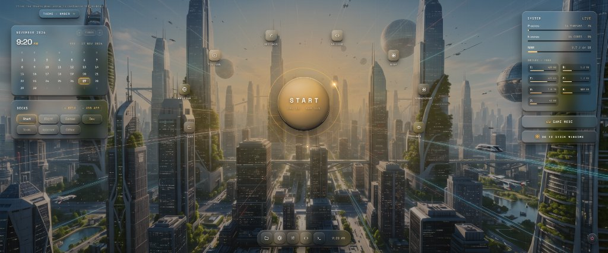
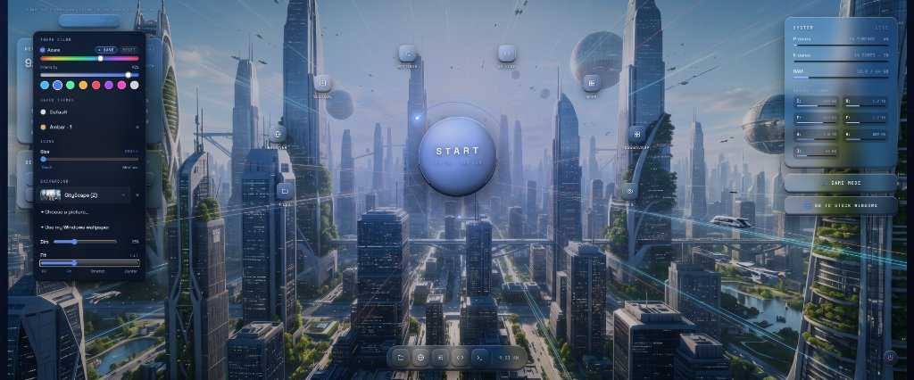
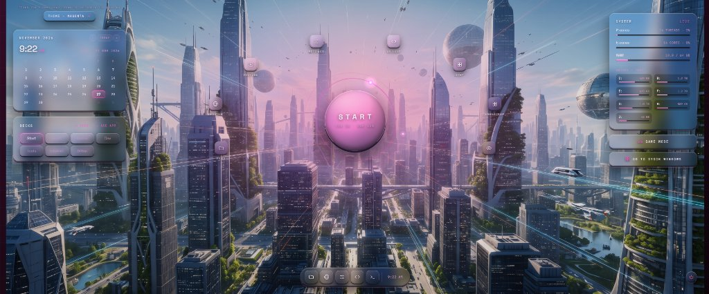

# Streamlined Desktop Overlay for Windows (SLW3D)

**A streamlined Windows 3D overlay to customize your Windows desktop to work for you — instead of Windows telling you how it should look.**

[](https://github.com/Vkng137/SLW3D/releases/latest)
[](https://ko-fi.com/vkng137)

> *"I built this because I got bored and tired of the old Windows desktop and having to search for things that I commonly use. I wanted a streamlined version with a little more 3D effect, customized around what the user actually uses instead of what Windows decides. I hope you enjoy it as much as I do."* — **Vkng137**

Built with .NET 10, WinForms + WebView2, and Three.js for Windows 10 and Windows 11 (64-bit).

---

## Screenshots

| Amber Theme | Azure Theme + Live Theme Menu |
|---|---|
|  |  |

**Magenta Theme**



---

## Video Walkthrough
- **Basic Use of SLW3D** — *(YouTube link coming soon — covers every click, deck, theme, Game Mode, and tip in action)*

---

## Disclaimer & Good Security Habits
- **Use at your own risk.** This software is provided "as is" under the [MIT License](LICENSE).
- **Overlay, not replacement:** SLW3D was built strictly to **overlay** Windows — it does **not** replace `explorer.exe`, patch Windows system files, or alter/delete your Windows desktop icons. You can step back to stock Windows at any time in one click or with `Ctrl+Alt+Shift+D`.
- **Always virus-check your downloads:** As a good everyday habit, always scan any file you download from GitHub (for example with Windows Defender or [VirusTotal](https://www.virustotal.com/)) and verify the SHA-256 checksum against `SHA256SUMS.txt` before running the installer.

---

## Key Features
- **Non-destructive desktop layer**: Attaches cleanly to Explorer's desktop layer (below all app windows, above desktop icons — never alters or hides your Windows desktop icons). Step back to stock Windows or Game Mode in one click.
- **3D Glass UI**: Interactive Three.js orbital centerpiece, floating app arc, up to **8 customizable decks** × **18 icons per deck** (staggered dual rings past 10 icons), plus a bottom search/dock bar for pinned apps.
- **Live Customization**: Top-right **THEME** menu with 360° Theme Color slider, Intensity, quick swatches, **Saved Themes** profiles, icon sizing (`Small · Medium · Large`), and wallpaper picker with Dim & Fit modes.
- **System & Power**: Live Clock & Calendar panel, System telemetry panel, one-click **Game Mode** (plus automatic Game Mode watcher), and bottom-left Power menu (Lock, Sleep, Restart, Shut Down with 2-click confirmation).
- **Global Hotkeys**:
  - `Ctrl+Alt+I` — Full 3D desktop
  - `Ctrl+Alt+G` — Toggle Game Mode
  - `Ctrl+Alt+Shift+D` — Emergency Panic restore (immediately closes the 3D shell and returns to stock Windows)

---

## Verified Resource Usage & Compatibility

### Resource Footprint
- **Full 3D Mode:** ~377 MB RAM total (`62 MB` controller + `61 MB` shell + `254 MB` WebView2)
- **Idle CPU:** ~0.0%–0.5%
- **Covered by a maximized app:** ~0% GPU (rendering pauses when covered; auto-throttles to 15 fps when idle)
- **Game Mode (`Ctrl+Alt+G`):** ~62 MB RAM / 0% GPU (the 3D shell shuts down completely)
- **Stock Windows (`Exit`):** 0 MB

### Compatibility & Reference Specs
- **Minimum Requirements:** Any 64-bit Windows 10 or Windows 11 PC (Intel or AMD CPU; NVIDIA, AMD, or Intel integrated graphics), ~400 MB free RAM, and Microsoft Edge WebView2 Runtime (pre-installed on Windows 11 and most Windows 10 systems).
- **Built & Tested On:** Windows 11 25H2, Intel i9-13900K, 64 GB RAM, RTX 5080 (tested on 3840×1600 ultrawide and standard 16:9 displays).

---

## Installation Guide (Windows 10/11 x64)

### 1. Download, Virus-Scan & Verify Checksum
1. Go to the [Releases](../../releases) page and download both:
   - `SLW3D-Setup-<version>-win-x64.exe`
   - `SHA256SUMS.txt`
2. Scan the downloaded `.exe` with Windows Defender (right-click → *Scan with Microsoft Defender*) or [VirusTotal](https://www.virustotal.com/).
3. Verify the installer's SHA-256 checksum in PowerShell before running it:
   ```powershell
   Get-FileHash .\SLW3D-Setup-<version>-win-x64.exe -Algorithm SHA256
   ```
   Confirm the output hash matches the hash in `SHA256SUMS.txt` (or run `sha256sum -c SHA256SUMS.txt` in Git Bash/Linux).

### 2. Run the Installer
1. Double-click `SLW3D-Setup-<version>-win-x64.exe`.
2. **Windows SmartScreen note:** Because open-source builds without a paid code-signing certificate do not have an established publisher signature yet, Windows may display *"Windows protected your PC"*. After scanning the file and verifying the SHA-256 checksum against `SHA256SUMS.txt` (built directly by GitHub Actions from this repository), click **More info → Run anyway** if you choose to proceed.
3. The installer installs per-user into `%LocalAppData%\Programs\SLW3D` (no Administrator prompt needed) and bundles the .NET 10 runtime.

### 3. Recommended First-Time Setup
- **Hide the Windows Taskbar (Recommended):** For the cleanest, edge-to-edge 3D desktop look, enable auto-hide on your Windows taskbar:
  - **Windows 11:** Right-click the taskbar → **Taskbar settings** → **Taskbar behaviors** → check **Automatically hide the taskbar**.
  - **Windows 10:** Right-click the taskbar → **Taskbar settings** → turn on **Automatically hide the taskbar in desktop mode**.
  *(You can still access Start and Search anytime from the bottom dock bar or by moving your mouse to the bottom edge.)*
- **Start at Login:** Right-click the **SLW3D** icon in the Windows system tray (bottom-right notification area) and enable **Start at login** if you want it to launch automatically when you sign in.

---

## Gaming & Performance Guide (Games Deck vs. Game Mode)

SLW3D gives you two ways to launch games depending on how demanding the game is:

- **Lightweight / Casual Games → Launch from the `Games` Deck:**
  For games that don't push your CPU, GPU, or RAM to the limit, you can add them to your **Games** deck (`+ ADD APP`) and launch them straight from the 3D overlay.
- **Graphically Intensive Games → Use Game Mode (`Ctrl+Alt+G`):**
  When playing demanding 3D/AAA or VR/sim titles where you want **100% of your system resources** (GPU, VRAM, CPU, RAM) dedicated to the game:
  1. Switch to **Game Mode** using `Ctrl+Alt+G`, the **Game Mode** button in the 3D shell, or right-clicking the system tray icon → **Game mode**.
  2. This completely shuts down the 3D WebView2/Three.js overlay and drops you cleanly back to the stock Windows desktop.
  3. Launch your game directly from the **Windows Start Menu** (or Steam/launcher) so no overlay overhead remains running.
  4. When you're done playing, press **`Ctrl+Alt+I`** (or double-click the tray icon) to bring SLW3D right back.
- **Automatic Game Mode Watcher:** The controller also watches for processes listed under `game_processes` in `config\controller.json` (generated on first run from `config\controller.example.json`) and automatically enters Game Mode while they run, then restores SLW3D after they exit.

---

## Customizing Your Desktop
- **Decks & Apps:** Opens on the **Start** deck with built-in Windows apps ready to go. Use `+ DECK` to create up to 8 custom decks and `+ ADD APP` to pick apps from your Windows Start Menu or add custom shortcuts. Right-click any tile to remove it from a deck, or right-click a dock icon to unpin it.
- **Themes & Colors:** Click the **THEME** dropdown at the top right to adjust the 360° hue slider, intensity, quick swatches, **Saved Themes** profiles, icon size (`Small · Medium · Large`), and custom wallpapers (Dim & Fit modes).
- **Tray Menu Controls:** Right-click the system tray icon at any time to switch modes (`Full 3D desktop`, `Manual control`, `Game mode`), trigger **Panic restore**, toggle **Start at login**, view logs, or **Exit (back to stock Windows)**.

---

## Uninstalling
Open **Windows Settings → Apps → Installed apps**, find **Streamlined Desktop Overlay for Windows (SLW3D)**, and click **Uninstall** (or use the Start Menu uninstall shortcut). Uninstalling removes the application files and cleans up the optional `SLW3D` login task.

---

## Building from Source
Requires the .NET 10 SDK (`net10.0-windows`):

```powershell
# Run tests
dotnet run --project tests\Desktop3D.Tests.csproj -c Release

# Build portable binaries into .\bin
.\build.ps1

# Build the Windows .exe installer + SHA256SUMS.txt (requires Inno Setup 6)
.\installer\build-installer.ps1 -Version 1.0.0
```

## License
MIT — see [LICENSE](LICENSE).
